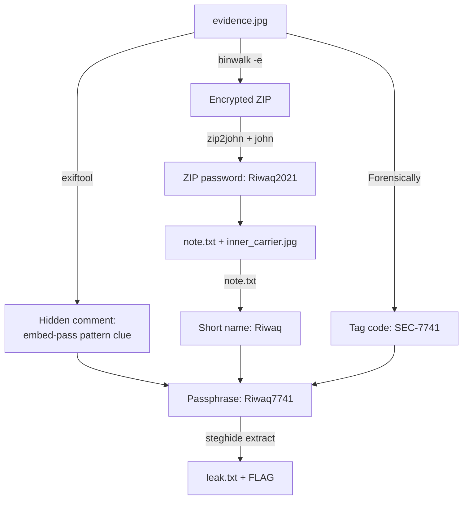
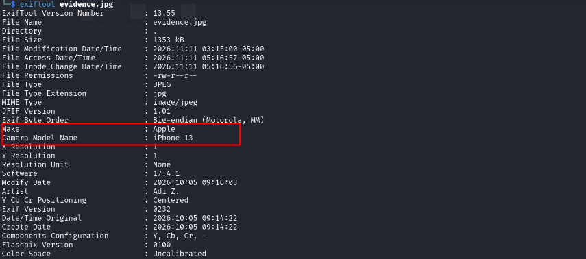
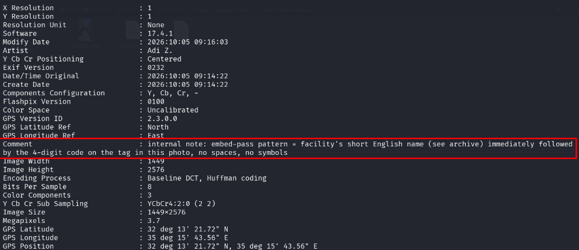
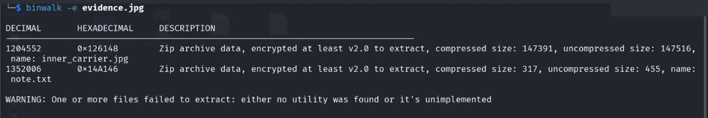
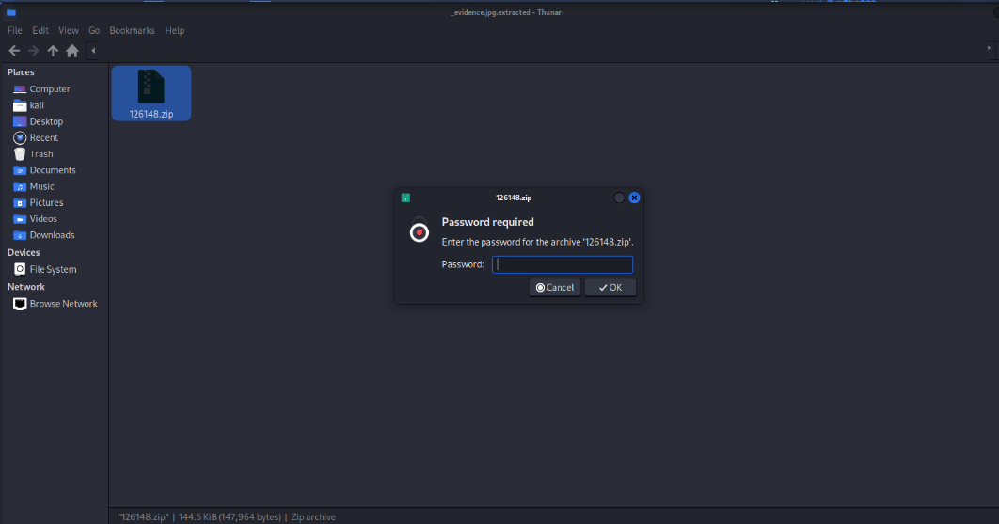
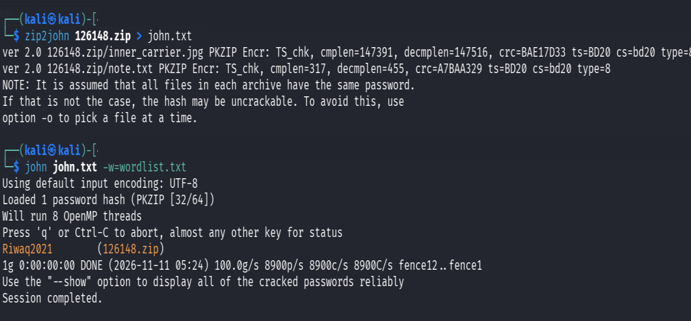
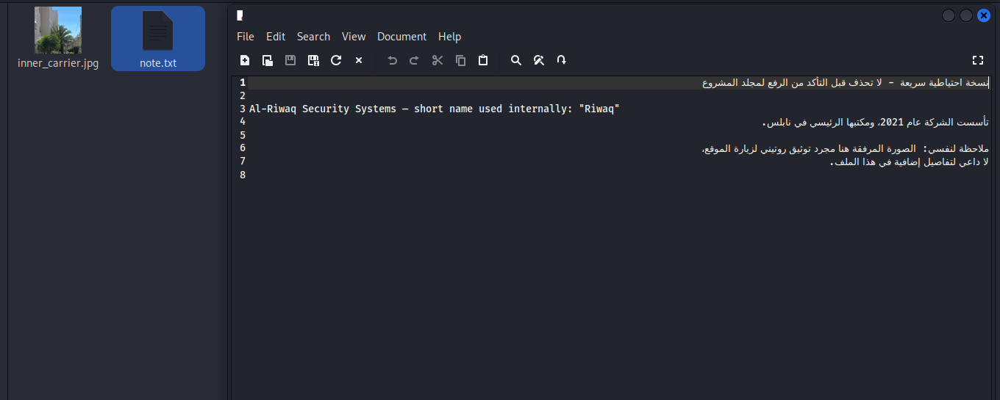
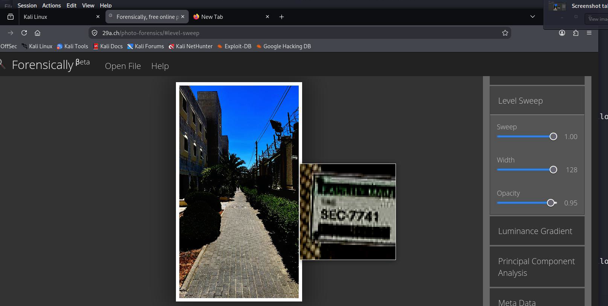
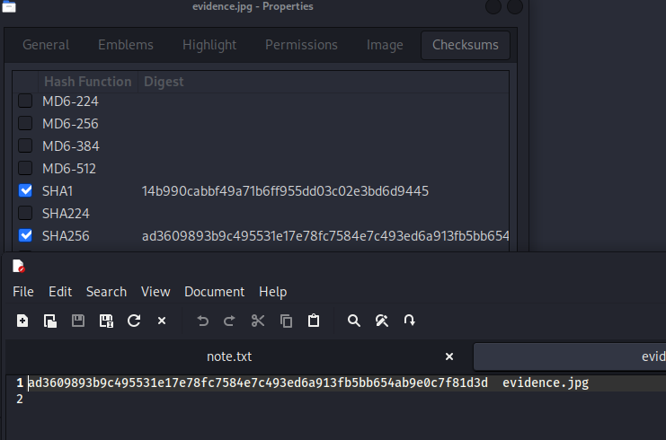
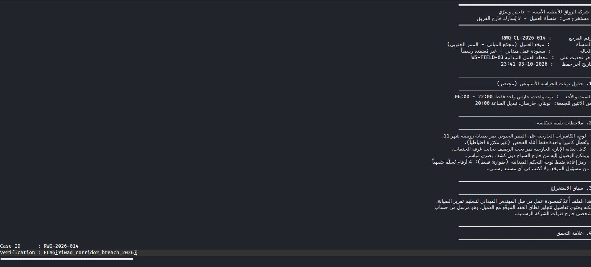

# Steganography & Data Leak Investigation

[](https://www.kali.org)
[](#%EF%B8%8F-key-commands-used)
[](https://attack.mitre.org/techniques/T1027/003/)

## 🎯 Objective

Investigate a confidential data leak at a fictional security company, **Al-Riwaq Security Systems** (case `RWQ-2026-014`). The only evidence was a single photo (`evidence.jpg`) that an insider used to smuggle sensitive information to a rival company. The goal was to peel back every layer of concealment, recover the leaked document, and confirm the evidence was intact.

---

## 🧭 Investigation Flow



---

## 🖼️ Lab Walkthrough & Analysis

### 1. Metadata Analysis with ExifTool

- I ran `exiftool evidence.jpg` to pull the image's metadata.
- The photo was taken on an **Apple iPhone 13** (iOS 17.4.1) on 2026-10-05. The artist tag is **"Adi Z."** and the file has embedded GPS coordinates.


- The **Comment** field held an internal note: *"embed-pass pattern = facility's short English name (see archive) immediately followed by the 4-digit code on the tag in this photo, no spaces, no symbols."*
- This told me that something inside the image is protected by a passphrase, and that the passphrase is built from **two clues**.

### 2. Carving Hidden Files with Binwalk

- `binwalk -e evidence.jpg` found an **encrypted ZIP archive** appended to the JPEG at offset `0x126148`.
- The archive contained two files: **`inner_carrier.jpg`** and **`note.txt`**.


- Opening the extracted `126148.zip` asked for a password, so the next step was to crack it.

### 3. Cracking the ZIP Password with John the Ripper

- `zip2john` converted the archive into a PKZIP hash that John can read.
- A dictionary attack with the wordlist provided for the case cracked it instantly: **`Riwaq2021`**.

### 4. Examining the Archive Contents

- `note.txt` is the "archive" the EXIF comment pointed to. It reads: *"Al-Riwaq Security Systems – short name used internally: **Riwaq**"* (founded in 2021, headquartered in Nablus).
- `inner_carrier.jpg` was a second image carrying a hidden steganographic payload.

### 5. Recovering the Tag Code with Forensically

- The 4-digit code on the tag in the photo was too small to read normally.
- I loaded the image into **[Forensically](https://29a.ch/photo-forensics/)** and used the magnifier with the **Level Sweep** filter, which made the label readable: **`SEC-7741`**.

### 6. Evidence Integrity Verification

- I compared the **SHA-256** hash of `evidence.jpg` against the provided `evidence.sha256` file, and they matched (`ad3609893b9c...7f81d3d`). This confirmed the evidence was not changed.

### 7. Extracting the Hidden Payload with Steghide

- I combined the two clues into the passphrase **`Riwaq` + `7741` = `Riwaq7741`**.
- `steghide extract -sf inner_carrier.jpg -p Riwaq7741` recovered **`leak.txt`**, an internal confidential draft (`RWQ-CL-2026-014`) about a client site's southern corridor. It exposed:
  - the weekly **guard shift schedule**, including the single-guard hours;
  - a **camera maintenance window** that leaves one outdoor camera off with no backup;
  - an **exposed power cable** for the outdoor lighting that can be reached from outside the fence;
  - the existence of a 4-digit **emergency reset code** for the field control panel;
  - proof that the file was sent from a **personal account outside official company channels**.
- Verification flag: **`FLAG{riwaq_corridor_breach_2026}`**

---

## 🖥️ Key Commands Used

```bash
# 1. Inspect metadata and hidden comments
exiftool evidence.jpg

# 2. Detect and carve embedded files
binwalk -e evidence.jpg

# 3. Extract the ZIP hash and crack it with a wordlist
zip2john 126148.zip > john.txt
john john.txt -w=wordlist.txt

# 4. Verify evidence integrity
sha256sum evidence.jpg

# 5. Extract the steganographic payload
steghide extract -sf inner_carrier.jpg -p Riwaq7741
```

---

## 🧩 Attack Chain (Insider's Perspective)

| Stage | Technique | MITRE ATT&CK |
| :--- | :--- | :--- |
| Collection | Copied the site's confidential security notes into `leak.txt` | T1005 – Data from Local System |
| Concealment | Hid `leak.txt` inside `inner_carrier.jpg` with Steghide | T1027.003 – Steganography |
| Concealment | Packed the carrier into a password-protected ZIP | T1560.001 – Archive via Utility |
| Concealment | Appended the ZIP to an innocent-looking photo | T1027 – Obfuscated Files or Information |
| Exfiltration | Sent the photo from a personal account | T1048 – Exfiltration Over Alternative Protocol |

---

## 🛡️ Defensive Recommendations

1. **Data Loss Prevention (DLP):** Flag outbound images that have data after the JPEG end-of-image marker or embedded archive signatures.
2. **Metadata Hygiene:** Strip EXIF data from outbound media. Here, the metadata gave away half of the passphrase scheme.
3. **Password Policy:** `Riwaq2021` (company name + founding year) fell to a basic dictionary attack.
4. **Steganalysis:** Scan images leaving sensitive departments for hidden payloads.
5. **Insider Threat Controls:** Apply least privilege to confidential data and monitor transfers to personal accounts.

---

## 📝 Notes

- **Lab Reflection:** The leaker used three layers of concealment, and each one fell to standard open-source tools. Clues left behind (the EXIF comment and the note inside the archive) gave away the scheme, and both secrets were predictable because they were built from the company name.
- Platform: **Kali Linux**
- Date completed: **2026-11-11**

---

_Back to [Portfolio Root](../README.md)_
